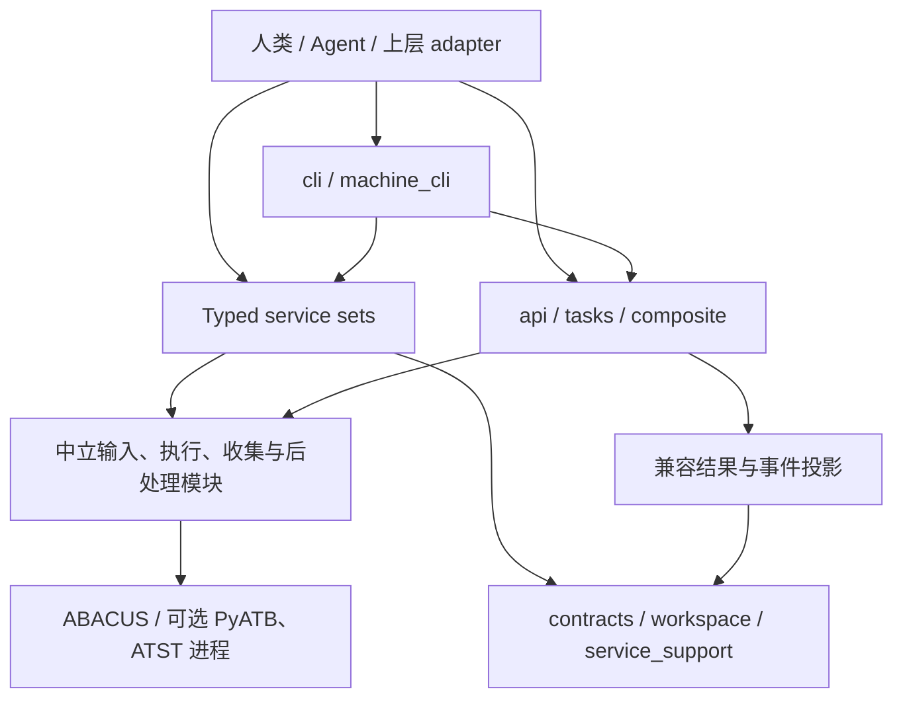

# Forge 现行架构与开发参照

Forge 提供协议与平台无关的 ABACUS 单元操作。调用者显式提供请求、工作目录和产物，Forge 返回输入文件、进程事实、解析结果与可追溯 artifact。科学接受、跨 workspace 工作流、调度和平台协议由调用者负责。公共边界以[契约优先 SPEC](superpowers/specs/2026-09-01-forge-contract-first-rearchitecture-design.html)和 [Service/Status SPEC](superpowers/specs/2026-09-02-forge-service-status-migration-design.html)为准；本文描述当前代码，不能改变规范。

## 调用面与依赖方向

箭头表示调用或依赖方向，不表示一次 operation 会自动执行全部阶段。`prepare`、`modify`、`execute`、`collect`、`postprocess`、`export` 各自受理、执行并记录事件。typed service 不通过 legacy `api.py` 或 task helper 实现；两者在下层共享输入、runner 和解析代码。`tasks.py`、sequence 与 packs 保留既有本地组合语义，不能据此扩大 typed operation 的职责。

根包 `__init__.py` 保留原有导出名称，按需加载其所属模块。基础文本 I/O 可直接导入 `abacus_forge.input_io`；这不意味着所有结构或科学功能都不需要第三方库。安装依赖保持当前 `pyproject.toml` 定义，候选调整见[路线图](../ROADMAP.md#可废弃与依赖调整候选)。

## 模块职责

所有源码路径相对 [`src/abacus_forge/`](../src/abacus_forge/)。模块按责任划分，不为每个 capability 复制完整框架。

| 责任 | 主要模块 | 维护边界 |
| --- | --- | --- |
| 人类 CLI 与机器协议 | `cli.py`、`machine_cli.py`、`discovery.py`、`request_registry.py` | 参数转换、请求解码、service 路由、outcome/error 渲染；discovery 与解码复用 request_registry 静态映射，不在 CLI 实现科学算法。 |
| 环境诊断 | `diagnostics.py` | 标准库读取安装元数据和显式程序/资产可发现性；不启动引擎、不写 workspace，返回独立 `forge.environment/v1` 报告。 |
| 请求和结果契约 | `contracts.py`、`*_contracts.py`、`errors.py` | 冻结记录、字段校验、operation identity 与错误类别；能力专用请求在各自模块。 |
| ABACUS typed operations | `services.py`、`service_support.py` | SCF/Relax/cell-relax/MD 复用 prepare/modify/execute/collect 基元；service 负责受理、状态和事件。 |
| 独立 typed operations | `postprocess_services.py`、`md_postprocess_services.py`、`pyatb_services.py`、`export_services.py`、`atst_neb.py`、`pyatb_cohp_services.py`、`polarization_services.py` | 各 capability 的显式输入与单次 operation；不隐式寻找 latest 或编排上游任务。IAO `cohp` 只受理 postprocess；direct NAO 的 `pyatb-cohp` 单独交接外部引擎。 |
| Workspace 与资产 | `workspace.py`、`assets.py`、`compatibility_records.py` | contained path、operation guard、manifest/event、资产来源与哈希；兼容记录转换集中维护。 |
| 输入与结构 | `input_io.py`、`structure.py`、`structure_recognition.py`、`modify.py`、`preparation.py`、`prepare_profiles.py`、`validation.py`、`perturbation.py` | INPUT/STRU/KPT、结构保真、任务默认参数及轻量修改；保留调用面不同的资源默认值。 |
| 执行与原始事实 | `runner.py`、`collection.py`、`collectors/`、`parser_backend.py` | 一次本地进程、原生输出解析和可选 parser 后端；不把正常结束或收敛观察升级为科学状态。 |
| 结果投影 | `result.py`、`collection_results.py`、`relax_results.py`、`md_results.py`、`pyatb_manifest.py`、`property_manifest.py` | typed 与 legacy 各自的结果边界、来源及 artifact；不以通用 result 消除兼容差异。 |
| 中立后处理 | `band_data.py`、`band_postprocess.py`、`dos_data.py`、`dos_postprocess.py`、`postprocess_algorithms.py`、`md_postprocess.py`、`cohp_iao.py`、`cohp_iao_reader.py`、`cohp_iao_shells.py`、`cube.py`、`polarization.py`、`bec.py` | 解析、表格、可选绘图与数值处理；band 共享实现不依赖 legacy unit。 |
| 外部引擎交接 | `pyatb.py`、`pyatb_typed.py`、`pyatb_cohp.py`、`atst_neb.py` | 明确的文件交接和本地 executable；引擎自身的图像/链路逻辑留给引擎。 |
| 导出 | `export_io.py`、`export_services.py` | 对调用方指定的既有事实序列化；不发布报告或做科学判定。 |
| 兼容消费面 | `api.py`、`tasks.py`、`unit_postprocess.py`、`composite/` | primitive、UnitSpec、task/sequence、pack 的已有行为；保留必要转发，复用中立内核。 |

## 必须保留的差异

- typed prepare 使用显式资产映射、默认 `copy`；legacy prepare 保留目录推断和默认 `link`。不能机械替换。
- typed band/DOS/COHP 当前只有 `postprocess`；COHP W1 只实现 IAO，不含 legacy subprocess bridge；legacy band/DOS task、unit 和 sequence 仍有自己的执行路径。
- typed PyATB 使用显式 workspace 内文件交接；legacy PyATB helper 保留自动发现的兼容行为。
- typed MD 从原生 running log 提取热力学事实，legacy synthetic dump 兼容解析继续存在。
- 共享 band 写表/绘图保留各调用面的源路径注释、能量轴和默认值。共享实现不代表输出协议统一。

具体调用和状态见[使用指南](guide.md)与[接口参考](reference.md)。`scientific=unassessed`、workspace-relative artifact 和追加式事件属于契约要求，不能用“清理代码”绕过。

## 修改入口与验证

| 要修改的行为 | 先定位 | 验证入口 |
| --- | --- | --- |
| 公共请求、错误、CLI 或 workspace 语义 | owning SPEC、contracts、machine CLI、workspace | `test_contracts.py`、`test_workspace.py`、相应 API/result 与 CLI parity 测试；设计未定先补 SPEC。 |
| 输入或结构保真 | preparation、input_io、structure、modify | 对应输入/结构测试及调用该行为的 service/API 测试。 |
| 新 capability 或 operation | 对应 contracts/services、共享 capability 映射、discovery | schema/discovery、解码错误、API/CLI parity、artifact/event；有真实进程才增加相应 smoke。 |
| 输出解析与后处理 | collectors、collection、对应中立算法及结果投影 | 小型真实格式 fixture、边界测试、typed/legacy 两侧回归；不能仅用手造 outcome 代替 parser 证据。 |
| 包导入或安装 | __init__、pyproject、模块依赖 | `test_imports.py`、架构检查、wheel 安装及 `test_package_contract.py`、`test_package_metadata_drift.py`。 |

完整分类、命令、默认离线门禁和真实运行验收在 [tests/README.md](../tests/README.md)。已有测试按最近行为边界扩展，不以 capability 数量复制测试框架。文档例子迁移也要保留真实 CLI 验证。

## 开发参照点

参照用于核对格式、能力和兼容性；不能把旧项目的上层对象、调度与平台语义搬入 Forge。

| 参照 | 使用方式 | 不继承的责任 |
| --- | --- | --- |
| ABACUS 对应版本源码与真实输出 | INPUT/STRU/KPT、日志标记、单位与产物格式的依据；按 producer 版本绑定证据。 | 由输出观察替代科学验收。 |
| Paimon v1.2 / `app-tools` | 结构与结果交付兼容、上层所需事实和迁移 parity。 | ATP、tool_data、平台文件发布、科学 policy。 |
| `abacustest` | 历史输入归一化、指标解析与兼容 fixture。 | 厚 workflow 和运行时依赖。 |
| `abacustools` | 输入/结构保真、LTS/develop 解析、后处理与性质阶段交接的独立参考；[采纳范围与 COHP 方法溯源](superpowers/plans/2026-09-09-forge-core-fidelity-references.md#integration-review-20261019)。 | 整包依赖、作业调度、workflow 编排、交互菜单及其不同的错误/回退语义。 |
| `abacuslab` / `abacuscopilot` | 输入模板、能力组织、解析和 UX 的局部参考。 | 整套编排与产品交互状态。 |
| PyATB / atst-tools | 对应引擎的明确输入、输出与进程契约。 | 引擎安装、站点调度与上层 workflow。 |
| 已结项 `paimon/` AiiDA 项目 | 历史设计与能力抽取证据。 | AiiDA Group、Node UUID 和上级规范地位。 |

具体 checkout、版本、文件和采纳/排除依据见[核心保真参考记录](superpowers/plans/2026-09-09-forge-core-fidelity-references.md)。当前跨仓 owner 入口在[设计与计划导航](superpowers/README.md#跨仓迁移)。新依赖或格式变更须核对实际源码/输出；历史记录中的路径和提交只证明当时参照，不代表自动跟随上游最新版本。
