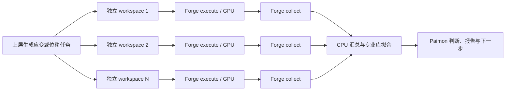

# Forge 设计、算法替代与可组合性审查

2026-11-05，针对用户要求的整体复核。本文是代码与证据审查，不是新的 SPEC 或实施计划；本轮未修改运行代码。

**结论：现有单元操作架构适合继续作为替代底座，核心实现与收缩设计基本对齐。Forge 原语、Paimon 自有领域算法及专业库已经组成主要替代路径；独立 Forge 包尚不等价覆盖全部旧算法，当前 Paimon candidate 也尚不能直接替代最新现役。工具拆分和独立 workspace 并行有实际基础，复杂工作流仍由外层组织。**

## 审查范围

| 对象 | 本次核对身份 |
| --- | --- |
| Forge | `git@github.com:QuantumMisaka/abacus-forge`；canonical `abacus-forge/`；`main@413cc4a6796a9c23cc6df53735ff916213c9d676`；package `0.1.0`。本轮 wheel 构建源码 `2dfcae8` 与该 HEAD 运行代码相同。 |
| Paimon v3 | `git@codeup-misaka.com:sidereus-ai/galileo-science-suite/science-suite-alpha/app-tools`；`app-tools-forge-latest-main-sync/`；`integration/paimon-v3-forge-replacement-20261030@586492ad3f453d776d824b91cb5a3196b555ea7c`；`toolbox/ABACUS`、toolbox `1.2.85`；SCF 默认且唯一 route 为 Forge，其余工具按实际 adapter/ATST 路径核对。 |
| 最新 Paimon v2 | 同一 app-tools repo 的 `origin/main@d2fd976c87771cb19f82d453d279067bb761fd00`；toolbox `1.2.87`；只读 `git show`，并用 `git ls-remote` 确认远端。canonical `app-tools/main@38c0f9073` 是旧 checkout，未将它当作最新现役。 |
| 旧库算法参考 | `abacus-agent-tools@6468a4f437ebc3b2c7cd8e0370907d9774766ef0`、`abacus-test@122c698e580a36e2e219bcb47a1f94bcd66fd46e`。这些是参考源码，不代表现役安装 pin。 |

本轮没有生成部署 kit 或 SIF。Paimon 配置仍锁定旧 Forge wheel `a4bba28e…`（build source `d9eb12a`、RC `d5585f5`），不能把本地新 wheel `dade7acf…` 的修复自动算入部署候选。干净环境及依赖清单见[本轮 Forge 安装证据](../2026-11-05-forge-review-followup/README.md)。

## 设计与代码是否一致

有效方向由 [Contract-First](../../specs/2026-09-01-forge-contract-first-rearchitecture-design.html)、[Service/Status](../../specs/2026-09-02-forge-service-status-migration-design.html)及[收缩设计](../../specs/2026-10-29-forge-computation-factory-target-architecture-design.md)共同定义。设计模式可以准确概括为：**单元操作服务 + 显式请求/事实结果 + 文件工作区 + 外层编排**。

| 设计承诺 | 已核查实现 | 判断 |
| --- | --- | --- |
| prepare / modify / execute / collect / postprocess / export 独立 | `services.py:214,286,405,545`、各专项 service、`machine_cli.py:341` | typed 主干已实现；execute 不隐式 collect，后处理不隐式重新计算上游。 |
| Python 与机器 CLI 共用契约 | `contracts.py`、`request_registry.py`、`discovery.py`、`machine_cli.py` | 版本化 request、outcome/error、schema discovery 已落地；13 个 typed capability 不等于整个 Python 能力全集。 |
| 运行、解析与科学接受分开 | `service_support.py:58`、`services.py`、`relax_results.py`、`md_results.py` | 有 execution/collection/observations；typed scientific 保持 unassessed。正常结束或采集完整不等于科学收敛。 |
| 不耦合旧包、ATP、平台调度 | `pyproject.toml`、生产 import 图、`tests/test_architecture.py` | Forge 包自身已解除这些运行时依赖；SAI/ATP 与科学策略保留上层。 |
| 同工作区操作与事件一致性 | `workspace.py:224,244,453`、`ServiceContext.persist` | typed service 在副作用前受理、锁内执行并提交事件；同 ID 拒绝重放，不是结果缓存或 workflow ID。 |
| 不建立重复框架 | 已撤回 Phase A registry；复用 discovery/runner/result/provenance | 与用户确认的消融方向一致，无需重建 ExecutionIdentity、ResourceSpec 或统一 DAG runtime。 |
| 渐进保留旧 API | `api.py`、`tasks.py`、`composite/` 与当前 architecture 的兼容说明 | 仍是两种消费面共存，不能将旧 API 的任意调用视为 typed 协议的一部分。 |

主干对齐不等于所有入口拥有相同保障。当前 Paimon 同时使用 typed ServiceSet、LocalRunner、UnitSpec/collect_unit、run_many 和自身科学分析。它已经超出“只做路径和报告投影的薄 adapter”；公共科学算法仍有一部分位于 Paimon。这里应按实际复用需求决定是否下沉，不为形式统一重写已经工作的算法。

## 能否替代旧两库的算法与能力

替代目标应是 Paimon 实际使用的计算职责，不包括旧库中未被消费的云提交、平台工作流或其他软件后端。

| 能力 | 当前实际 owner / 实现 | 替代判断 |
| --- | --- | --- |
| INPUT/STRU/KPT、结构修改、PP/ORB 组织 | Forge `input_io.py`、`structure.py`、`modify.py`、`preparation.py`、`assets.py`；Paimon 持有资源选择及输入策略 | 主要底层职责已替代旧 ReadInput/AbacusStru/PrepInput 等；存在实际算法与资产处理。 |
| SCF/Relax/cell-relax/MD 执行、收集 | Forge runner、typed services、native/abacuslite parser、结果投影 | 核心路径已实现；Relax/MD 站点启动参数仍有消费缺口，见下文。 |
| Band/DOS/PDOS | Forge 文件解析、能量参考、PDOS 分组和绘图；Paimon 组织 SCF→NSCF 或 PyATB 链路 | 算法与接线已有实现，不应因 typed discovery 仅列 postprocess 就判定未完成。 |
| MD 数据分析 | Forge `md_postprocess.py` 实现轨迹展开、最小镜像、MSD/VACF/RDF | 实际算法已存在；适用轨迹/单位按消费路径核验。 |
| Bader、电荷差、自旋密度、功函数 | Forge cube/平面平均/执行基元，Paimon 对应 adapter 与结果解释；Bader 由外部专业程序执行 | 不需要 Forge 重写 Bader 算法；不能只凭 ACF.dat 路径推定逐原子结果解释等价。 |
| EOS | 当前 Paimon `eos_forge.py:195`→`eos_fallback.py:247` 的三阶 Birch–Murnaghan 拟合；Forge 执行与采集 | 有完整替代路径，算法尚未下沉到独立 Forge EOS pack。 |
| Elastic | Paimon `elastic_forge.py:103` 使用 pymatgen independent-strains；`elastic_properties.py:37` 提供 Voigt/Reuss/Hill 等派生量 | 有完整数值路径；不能用 Forge 简化 pack 的模量实现代替它。 |
| Vibration | Paimon `vibration_forge.py:348` 组织位移/力缓存，再用 ASE Vibrations、HarmonicThermo | 有频率、ZPE 与热力学计算，不是空占位；Forge 负责计算基元。 |
| Phonon / phono3py | Paimon `phonon_forge.py:94,270,615` 强制依赖 phonopy，生成真实位移、力常数、DOS/band/热力学；其他驱动使用专业库 | 当前主路径没有 Forge pack 的缺依赖伪位移 fallback；真实引擎数值 parity 尚待验收。 |
| PyATB、IAO/direct NAO COHP、BEC | Forge 对专业引擎的显式交接及有界本地数值核；Paimon 负责流程和展示 | 已有实际实现和部分历史真实数值证据；方法不同，IAO 与 direct NAO 不可无条件互换。 |
| CP / Transition / NEB / ASE 驱动 | 当前 Paimon 的 `constant_potential_operations.py`、`transition_atst.py` 等复用 ATST/ASE；Forge 另有显式 ATST NEB adapter | 不依赖旧两包的专业驱动可继续保留，不必为了迁移强制全部套成 Forge capability。 |

Paimon 的当前替代代码远超 SCF：active legacy import audit 已记录 0 records/0 files，SCF legacy route 已退役。最新 full-suite 记录为 8128 passed / 1 skipped / 57 deselected（实现 `121761c69`，至 `586492ad3` 只增文档）。这些证据支持离线实现进度；历史测试环境仍可导入旧包，不能由零 import 与全绿推定所有能力均已在无旧包镜像运行。

对应跨仓源码位于审查身份表所列 Paimon checkout 的 `toolbox/ABACUS/`。算法验收记录为其 `docs/superpowers/evidence/2026-11-02-paimon-v3-{eos,elastic,vibration,phonon-backend}-forge/evidence.md`，主要是 synthetic forces、fixture 或注入执行；没有把它们当当前候选真实 Benchmark parity。

## 本轮发现与处置

**F1 — P2：timeout 未保证 launcher 后代退出。需要修复。**

[runner.py](../../../../src/abacus_forge/runner.py) 第 173–196 行用 `subprocess.run(timeout=...)`，未管理独立进程组。干净已安装 wheel 的离线探针中，直接进程超时返回 `failed/timeout` 后，后代仍写入同一输入目录：

```text
marker_at_return = false
marker_after_return = true
probe_child_running = false  # 写入后已自然退出
```

[探针源码](timeout_probe.py)与[实际输出](timeout-probe.txt)已保留。typed service 在 runner 返回后提交事件并释放操作锁，因此新 ID retry/collect 可能与残留旧引擎冲突。真实 MPI launcher 是否自行清理后代取决于实现。处置是在既有 runner 生命周期中终止并等待受控本地执行树；回归应覆盖 launcher 后代，而不仅直接进程超时。本轮只记录，未修代码。

**F2 — 独立 Forge 的四个 composite pack 不等价于 Paimon 的成熟方法。需要明确限制并修正误导状态。**

- [eos.py](../../../../src/abacus_forge/composite/eos.py) 第 67 行只有二次 E(V) 拟合，不能替代 Birch–Murnaghan 的 E0/V0/B0/B0′。
- [vibration.py](../../../../src/abacus_forge/composite/vibration.py) 第 84 行只汇总力范数，`frequencies=[]`、`zpe=None`，仍可返回 completed。
- [elastic.py](../../../../src/abacus_forge/composite/elastic.py) 第 198 行使用 mean(C44,C55,C66) 作为剪切模量，一般情况下不同于旧算法与当前 Paimon 使用的 g_voigt。
- [phonon.py](../../../../src/abacus_forge/composite/phonon.py) 第 26–62 行在缺 phonopy 时复制未位移原结构，并返回 prepared；不能据此得出有效声子位移集。

这些接口可由 legacy CLI 调用，不能只因 experimental 就忽略结果含义。处置优先修正状态/方法说明和缺依赖行为；若有独立 Forge 消费需求，再复用完整方法。当前 Paimon 对应算法另有实现，因此不把这些限制误报为当前 Paimon 缺少 EOS/振动/声子算法。

**F3 — Relax/MD 的真实消费者已有 launcher/env 需求，但当前接缝未传递。需要补齐已有执行接口。**

Paimon `toolkits/forge_scf_consumer.py:479–495` 对非 SCF 仅记录 `launcher_and_env_overrides_not_accepted_by_relax_md_typed_request`，实际 request 没有这些参数。Forge 原裁决仅扩展 SCF 是有界设计；当 Relax/MD 开始消费同一站点启动方式时，这成为实际集成缺口。不能宣称已承接现役 ABACUS_COMMAND_ARGV 全语义。下一次按实际需求扩展并验证共享启动传递即可，不需要通用资源框架。

**F4 — 当前 candidate 未对齐最新 v2，且未消费本轮 Forge 修复。阻断“可直接替代现役”的确认。**

- candidate 与最新 v2 的共同基线是 `ca0344105`，当前落后 173 个上游提交；此次只读审查不合并生产代码。
- 最新 v2 的 GPU `mpi_mode=0` 已表示直接 1 rank、OMP=n_gpu×4；candidate 的旧 GPU 分支仍忽略 mpi_mode，consumer 第 488 行固定 mpi_ranks=n_gpu。
- 最新 v2 还改进 SCF consumer_ready 三态/partial、runtime observation/evidence、Flow inputs 端口和结构交接；AST 枚举显示最新 v2 的 `stru_basic_compare` 尚不在 candidate（105 对 104 个直接 Tool 类，数量本身不作验收门槛）。
- candidate `config/configure.json` 与 `container/2.0/shared/forge-pins.env` 仍绑定旧 wheel `a4bba28e…`，与新源码的 `contracts.py`、`input_io.py` 有运行差异。
- SIF 最新记录明确 actual build / in-SIF validator / real representative operations / Benchmark parity pending。没有当前完整部署候选可据以确认替代。

处置是同步最新 v2 合同、采用实际新 Forge 包并对变化部分验收。历史成功证据可在源码/输入/环境适用时复用；不要求无差别重算所有历史任务。

## 工具拆分、并行和复杂编排

用户进一步指定的声子谱、弹性常量与振动分析，已在[并行展开专项 report](phonon-elastic-vibration-parallel-report.md)逐链核对并登记 PAR-01 至 PAR-06。三条链均有独立子工作区，但当前 adapter 全部固定 `max_workers=1`；专项新 wheel 消费回归为 33 passed，不代表真实 GPU 并行验收。
同日用户确认先交付可展开、独立执行与汇总的架构能力，具体资源分配后续接入；默认串行本身不否定可并行架构，优先补齐外层可消费的单元与结果交接。

| 问题 | 当前支持程度与使用边界 |
| --- | --- |
| 能否按 prepare/execute/collect/postprocess 拆工具 | 可以。typed 原语已有独立输入输出；Paimon 已有准备、修改、runner/collector、CP/Transition 阶段工具及弹性 CPU 派生工具。但 phonon 等内部阶段仍封在单个 Tool，不等于已全部独立暴露。 |
| 不同 workspace 同时运行 | typed service 有 barrier 回归证明并发进入 runner，事件相互独立；不使用进程级 chdir/环境覆写。资源配额、GPU 绑定、MPI 档位由调用方保障。 |
| 同一 workspace 同时修改 | typed operation 用线程锁与 flock 串行化；相同 ID 拒绝重复受理。legacy api/run_many/composite 未使用完整 typed operation guard，不能与 typed 路径混写后仍声称有同样保障。 |
| 批量参数扫描/位移/应变展开 | `run_many(max_workers)` 已有本地线程池；不是多个 Slurm allocation 的调度器。当前 Paimon EOS/elastic/vibration/phonon 多为 max_workers=1，charge-diff 默认并发 3 项且共用同一资源参数。放大并行度前须分配各任务资源。 |
| 批量失败隔离 | 普通引擎失败可返回单项 RunResult；意外 Python/I/O 异常可使 executor.map 整体抛错，不保证完整结果列表。上层若要求每个分支都可恢复，需分别收集 future/结果。 |
| 跨节点工件交接 | 支持显式文件与事实；typed 输入通常须先落到目标 workspace。通用跨 workspace resolver 尚不存在，上层负责复制所需工件、记录来源并绑定 ATP 端口。无需因此建设全局项目框架。 |
| fan-out/fan-in、条件分支、重试/续算 | 可以把 Forge 当同步节点接入外层 workflow。依赖判断、队列、checkpoint、资源申请、重试策略和科学接受归 Paimon/平台。UUID operation_id 不是幂等缓存键，重试使用新 ID；F1 修复前不能承诺超时后完全隔离。 |
| 历史结果与快照 | event/facts append-only；stdout/stderr、inputs 等文件可被后续操作覆盖。artifact ref 不自动冻结文件字节。需保留某次尝试时使用独立 workspace 或显式归档。 |

以弹性/声子为例，合理的组合形态是：



外层给每个 execute 分支明确 allocation/launcher；失败分支独立处理。现有结构适合这种拆分，不要求每个内部函数都暴露成一个 Tool，也不要求 Forge 内置 DAG。工具粒度应由跨节点复用、资源不同或可独立恢复的实际需求决定。

## 建议的下一批工作

1. 修复 Forge 已证实的 timeout 生命周期缺口，校正简化 pack 的方法/状态承诺；按实际 Relax/MD 消费需要补齐启动参数传递。保持现有架构。
2. 在 Paimon v3 上同步最新 v2 行为并采用新 Forge wheel，确认完整镜像真正不需要旧两包。数值方法已在专业库/Paimon 正确实现的部分，先复用，不为统一目录而重写。
3. 用实际的“多 workspace 展开→GPU 执行→CPU 汇总”链验证独立失败与重试、资源映射和文件端口，再绑定同一候选完成相应 Benchmark parity。这样同时检验替代与未来复杂任务能力。

## 验证边界

- 复用当前运行源码的全离线 1676 passed / 33 skipped、干净 wheel installed-only 595 passed，以及默认 SCF factory 的 stub 成功/失败交接证据。
- 本轮额外在同一干净 wheel 上运行两份 opt-in compatibility fixture 与架构检查：**14 passed**，命令与原始输出见[compat-architecture.txt](compat-architecture.txt)。这验证核心四 capability 的解析事实投影与包边界，不是 ABACUS Agent 全任务 Benchmark。
- 本轮 timeout 探针在已安装 wheel 复现 F1，子进程已自然退出；没有调用 ABACUS、SAI 或 GPU。
- 历史 develop/LTS 八格运行、COHP 数值对照、BEC 单列响应与 ATST 轨迹回放证明项目已有真实技术积累；各自绑定旧候选与输入，不能替代当前部署组合的验收。相关入口保留于[证据索引](../../README.md)。
- 本次整体审查采用三个有界只读取证分工（算法、Paimon 消费、并发/交接），由主代理核对关键源码及原始输出并汇总；未新增实施计划或审批机制。
