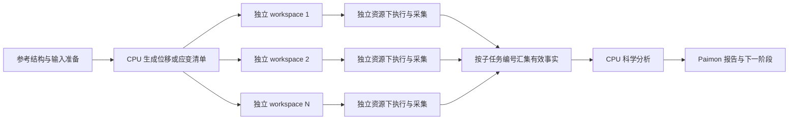

# 声子谱、弹性常量与振动分析：并行展开专项 report

2026-11-05。面向 Forge / Paimon v3 开发维护者，回应“并行展开”在三个具体科学任务中的实现状态。本报告补充[整体架构审查](README.md)。第 1–6 节保留初次只读审查与离线验证的基线；用户随后授权的 Forge 实现与缺陷状态更新见第 7 节，未发起平台计算作业。

**确认：三个任务在输入确定后都能展开为独立 ABACUS 子计算，现有 workspace 和执行基元适合承接；当前 Paimon candidate 三条链却全部固定 `max_workers=1`。因此已具备算法和文件拆分基础，尚未交付按子任务分配资源、并行执行、独立恢复、CPU 汇总的完整链路。现有架构无需推倒重建。**

**同日用户明确优先级：先完成架构上的任务展开和可组合消费，具体资源分配后续接入。** 当前首先要能生成单元清单、单独执行或采集任意单元、按编号汇总结果；这一能力可以用本地受控执行器验证，不以 SAI/GPU allocation 完成为前提。`max_workers=1` 只是当前批量入口的执行策略，不能单凭它判定架构不能并行；关键是调用方能否取出单元并独立调度。前版把真实资源接入放入首个架构切片，现据此调整推进顺序。

## 1. 本次绑定的代码与环境

| 对象 | 身份和适用范围 |
| --- | --- |
| Forge | repo `git@github.com:QuantumMisaka/abacus-forge`；checkout `/home/james/work/sidereus/workplace/abacus-forge`；审查起点 `main@7c9759cfc5b1e1d3caf0878743750ae794a1d975`；package `0.1.0`。运行源码与构建提交 `2dfcae89f73a5e128f7f12dae585d99607c93597` 相同。 |
| Paimon v3 | repo `git@codeup-misaka.com:sidereus-ai/galileo-science-suite/science-suite-alpha/app-tools`；checkout `/home/james/work/sidereus/workplace/app-tools-forge-latest-main-sync`；branch `integration/paimon-v3-forge-replacement-20261030`；commit `586492ad3f453d776d824b91cb5a3196b555ea7c`；路径 `toolbox/ABACUS`，toolbox `1.2.85`。下文三个 backend 均为 Paimon 自有科学算法 + Forge `LocalRunner/run_many/collect`，不是直接调用 Forge 同名 composite pack。 |
| 本轮离线消费环境 | `/home/james/scratch/forge-followup-20261105/venv`；Python 3.12.13；pytest 8.4.2；非 editable Forge `0.1.0`；ASE 3.29.0、phonopy 4.9.0、pymatgen 2026.10.24。wheel SHA-256 `dade7acf408bc61e945297caa8349ff94a660c9384ac69e1c40aa5899a3809ad`；完整依赖与制品绑定见[安装记录](../2026-11-05-forge-review-followup/README.md)及[依赖清单](../2026-11-05-forge-review-followup/requirements.txt)。 |

未生成 kit manifest 或 SIF，故不存在本轮部署镜像身份。Paimon 配置仍 pin 旧 wheel `a4bba28e…`；本轮新 wheel 的消费验证不能自动算入该部署候选。候选落后最新 v2、真实资源闭环与 Benchmark 状态沿用[整体审查 F4](README.md#本轮发现与处置)，本报告不以历史成功替代当前组合验收。

## 2. 三条链究竟如何展开

| 科学任务 | 当前生成的独立单元 | 汇总计算与依赖 | 当前拆分和恢复状态 | 实际子任务并发 |
| --- | --- | --- | --- | --- |
| 声子谱 | phonopy 生成的 `N_disp` 个位移超胞，每个单独 SCF 求力；数量随结构、超胞和对称性变化 | 按位移编号收齐有效力 → 力常数 → band / DOS / 热力学 | 内部已有 prepare / execute / postprocess；公开 Tool 仍一次完成整链；同一 `phonon_work_path` 可跳过已验证的力结果 | **1** |
| 弹性常量 | 3 个法向应变方向 × 4 幅值 + 3 个剪切方向 × 4 幅值 + 1 个平衡参考 = **25** 个 relax / stress 计算；当前 `symmetry=False` | 平衡应力与 24 组应变—应力 → pymatgen 拟合完整弹性张量；再计算派生模量 | 主 backend 仍为一个函数；每次新建 root；没有同等续算入口 | **1** |
| 振动分析 | 对 M 个选定原子，各做 x/y/z 正负位移，共 `6M` 个 SCF 求力，加 1 个参考，共 **6M+1** 个计算 | 按 atom / axis / sign 汇集力 → ASE 中心差分 Hessian → 频率、振型与热力学 | 内部已有 prepare / execute / analyze；公开 Tool 一次完成整链；每次新建 root，execute 重跑全部单元 | **1** |

这里的“独立”指输入生成后子计算之间没有数据依赖。单个 SCF/relax 内部的电子迭代、离子步以及 MPI 并行仍由 ABACUS 处理。声子/振动所需的参考结构优化、弹性所需的参考晶胞准备，应作为上游步骤；不能把输入准备不足归咎于并行机制。

### 声子谱：已具备最接近目标的阶段划分

[phonon_forge.py](../../../../../app-tools-forge-latest-main-sync/toolbox/ABACUS/toolkits/phonon_forge.py) 第 246–410 行调用真实 phonopy 生成位移集，并为每个位移创建独立 `disp-N/inputs`、outputs 和 reports。现有测试中的单原子三斜晶胞产生 3 个位移任务；这是该 fixture 的结果，不是声子计算的固定任务数。

第 473–537 行先尝试采集已有结果，只在 collection completed、normal_end、converge 均满足且力为有限的 N×3 数组时复用；其余任务进入 pending 列表。第 439–444 行仍串行运行 pending。第 512 行按原位移计划顺序组装力，第 602–615 行重新核对位移身份和数量后构造力常数。因此改为并发时应保持“位移编号 → 力”的对应关系，不能按完成先后直接拼接。

现有计划身份用于防止不同结构、位移步长或位移集的力混用，有具体科学保护对象，可以保留。它不需要扩张为全局 ExecutionIdentity。当前 plan 保存绝对工作区路径；共享同一路径的文件系统可消费，迁移到独立节点目录时还需重新绑定文件位置。

### 弹性常量：25 个任务可以同层展开

[elastic_forge.py](../../../../../app-tools-forge-latest-main-sync/toolbox/ABACUS/toolkits/elastic_forge.py) 第 58–91 行构造 24 个变形，第 188–221 行在执行前一次性生成 reference 与全部 deformed 子工作区。所有变形来自传入的参考结构，**没有先执行 eq、再用 eq 输出生成其余任务的代码依赖**。因而在参考输入合适的前提下，25 个计算可以同层展开；若需要先全局优化，应显式放在该阶段之前。

每个单元用 `calculation=relax`、`cal_stress=1`，内部离子弛豫可以独立进行。第 238 行固定串行执行。第 256–280 行按子工作区和 deformation 配对，将 ABACUS stress 转换为 pymatgen 所需应力，再由 `ElasticTensor.from_independent_strains` 拟合。缺失、未收敛或非有限应力会终止汇总，这个完整性条件应保留。

当前函数把准备、执行、采集、拟合都封在一起；结果清单 `elastic_forge_facts.json` 到拟合成功后才写入。相比声子，优先工作是提取已有阶段函数和恢复入口，无需重新实现弹性算法。

### 振动分析：按原子、方向和正负位移展开

[vibration_forge.py](../../../../../app-tools-forge-latest-main-sync/toolbox/ABACUS/toolkits/vibration_forge.py) 第 130–185 行生成 eq 与每个选定原子的六个正负位移工作区；M=1 时是 7 个任务，M=10 时按当前实现是 61 个任务。所有输入直接来自参考结构，eq 不生成其他位移输入，能够同层执行。

第 258–263 行固定串行；第 282–294 行按 workspace 找回位移 key 并校验力。第 348–395 行集中写入 ASE cache，再用 `Vibrations(..., nfree=2)` 完成分析。这种集中汇总可继续使用，分支无需同时写同一个 ASE cache。当前 execute 没有声子式的有效结果复用；再次调用会重跑全部单元。内部阶段分离也尚未变成可独立调度的 Tool。

## 3. 资源与编排边界

目标链路可以直接落在现有设计上：



这是所需组合方式的示意，当前三个公开 Tool 尚未按此拆开。对应入口为 [abacus_phonon.py](../../../../../app-tools-forge-latest-main-sync/toolbox/ABACUS/abacus_phonon.py) 第 41、157 行，[abacus_elastic.py](../../../../../app-tools-forge-latest-main-sync/toolbox/ABACUS/abacus_elastic.py) 第 59、167 行和 [abacus_vibration.py](../../../../../app-tools-forge-latest-main-sync/toolbox/ABACUS/abacus_vibration.py) 第 41、172 行。CPU 分析代码仍在同一次 GPU Tool 调用中执行；弹性已有额外的 CPU 派生性质 Tool，但主链的张量拟合仍在 worker 内。

Forge [run_many](../../../../src/abacus_forge/runner.py) 第 360–394 行已有 `ThreadPoolExecutor`，`max_workers>1` 会并发处理不同 workspace；`executor.map` 的返回列表保持输入顺序。它共用传入的一个 LocalRunner，**不为分支申请 allocation，也不划分可见 GPU、CPU、MPI launcher**。三条 Paimon adapter 当前传入同一套 `n_gpu`、OMP 和 launcher，因此 `n_gpu=4` 表示单次 ABACUS 启动的资源参数，不能解释为四个独立位移任务。显式 launcher 存在时实际命令由 launcher 决定，`mpi_ranks=n_gpu` 也不构成运行观察证据。

ABACUS 默认 GPU、后处理 CPU 的职责分工可以保持。实现并行可选择平台为每个单元申请资源，或在一次已获得的 allocation 内由调用方显式划分子资源；并非必须拆成多个 Slurm job。例如已获得 16 GPU、每个子计算确需 4 GPU，GPU 容量上界是同时 4 个，但还要满足 CPU、内存和 launcher/GPU 绑定；这只是容量示例，不是新的产品档位或策略。仅把 `max_workers` 从 1 改为 4 无法提供这些保证。

上述资源要求适用于后续真实 GPU 并发启用，不阻塞当前的任务展开接口、单元隔离与汇总逻辑开发。架构只需让每个单元能接收调用方给出的执行配置，保留已有 launcher/env 接缝；当前无需定义分区、GPU 档位、资源池或调度策略。

对复杂任务编排，最小交接信息是：固定的科学输入与子任务编号、对应输入/结果文件、每项执行状态、可用的力或应力，以及汇总所需的计划。资源申请、重试选择、依赖图归 Paimon/平台；Forge 保持单元执行和事实采集。批量单元可通过一个“执行指定单元/子集”的适配入口供外层展开，不必为每个位移创建新的 Tool 类型，也不必增加通用 registry 或内置 DAG runtime。

## 4. 当前缺陷和缺口登记

以下条目在第 1 节绑定的初审代码版本均为 **open**；第 7 节登记后续实现的分层关闭状态。功能缺口不等同于当前串行计算会算错。

| ID / 性质 | 触发、现状与影响 | 归属与最小处理 | 关闭所需证据 |
| --- | --- | --- | --- |
| PAR-01 · 独立单元消费缺口，当前优先 | 三个 adapter 已生成子工作区，但公开 worker 仍只接整链，内部 execute 接整批且固定 `max_workers=1`。调用方缺少完整的“展开清单→执行任意单元/子集→独立汇总”消费面。定位：phonon 439、elastic 238、vibration 258 行。 | Forge 基元与 Paimon 领域 adapter 协同；先使单元可枚举、可独立消费，沿用既有执行/采集接口。整链便捷入口可以保持默认串行，不要求先新增并发参数或资源框架。 | 用受控本地执行器证明单元可独立、乱序或并发执行；不串写工作区；按编号汇总一致，缺失项明确可见。无需真实 GPU allocation。 |
| PAR-02 · 资源接入缺口，后续集成 | `run_many` 共用 runner，三条链共用启动参数；直接提高并发数可能同时使用同一批 GPU/CPU。当前串行没有由此触发的已证实超额占用。此项不阻塞 PAR-01 的架构交付。 | Paimon / 平台负责每项 allocation 或显式子资源分配；Forge 消费各自 launcher/env。三条链直接传 launcher，**不属于整体审查 F3 的 typed Relax/MD 参数丢失路径**。 | 后续真实运行记录每项实际 launcher、MPI/OMP 与 GPU 可见范围；分支资源互不冲突且总量受限。不能仅验证 requested resources。 |
| PAR-03 · 拆工具与迁移交接缺口 | 三个公开 worker 均包住整链，CPU 拟合继续占用同次 GPU Tool allocation。elastic 内部也未拆阶段；phonon/vibration plan 记录绝对路径，目录迁移不会自动重绑定。 | Paimon adapter / Flow；按 CPU 准备、GPU 单元执行、CPU 汇总拆接既有函数。复用文件端口并记录单元与文件的对应，允许原路径共享或显式重定位。 | 在不同任务目录完成 prepare→分支→汇总；不依赖上个节点的内存对象或原绝对路径；CPU 汇总能单独运行且不重跑 ABACUS。 |
| PAR-04 · 恢复与失败汇总缺口 | 声子已有有效力复用；elastic/vibration 没有等价续算路径。任一普通执行失败后 adapter 抛出异常，中断最终汇总；elastic 的批次 facts 仅成功拟合后落盘。原始子目录/日志仍可存在，但不等于完整的逐项恢复记录。 | Paimon adapter；复用声子的逐项检查思路，持久化已成功、失败与待运行单元的事实，允许只执行无效/缺失子集。 | 中途一个任务失败后，重启只重算该任务；已通过验证的力/应力不重复执行；失败批次仍能定位每项结果且不产出伪完成的谱/张量。 |
| PAR-05 · 执行生命周期风险 | 三条链直接用 legacy `run_many`，不经过 typed workspace operation guard；同一 root 重入或重复派发同一单元无等价防护。另有已复现的 runner timeout 后代残留，见整体审查 F1。三条链当前 `timeout_seconds=None`，不能说它们已触发该 timeout 缺陷。 | Forge runner 管理受控进程生命周期；Paimon 保证单元只有一个活动执行者，或复用既有 typed 保护。重入风险来自代码路径，未做双调用复现；timeout 有独立探针证据。 | 同一单元重复派发不会并行写入；配置有限 timeout 后，受控旧执行树退出后才允许重试/采集。保护不同 workspace 的并行能力。 |
| PAR-06 · 非预期异常的批次结果缺口 | `executor.map` 中普通非零退出可返回 RunResult，但 Python/I/O 异常会让 `run_many` 抛错，调用方拿不到完整结果列表；其他分支可能已完成。当前 adapter 没有独立 durable 分支汇总。 | Forge 批量 helper 或外层逐项调度器；在实际使用的那层保留逐项异常和成功事实，不强制新增全局任务系统。 | 注入一个分支 I/O 异常，其他分支成功证据仍可枚举；失败原因可定位且恢复不重复成功计算。 |

另有两个适用范围必须保留：独立 Forge 的同名 phonon/vibration/elastic pack 存在简化或不完整实现，见[整体审查 F2](README.md#本轮发现与处置)；本报告中完整算法位于 Paimon adapter 与专业库，不能拿简化 pack 直接替换。当前候选与最新 v2、部署 pin 的差异也仍需在 Paimon 实质开发前处理。

## 5. 最小推进顺序与具体验收样例

1. **先贯通声子的可组合单元消费。** 它已有计划、阶段划分和有效力复用。暴露位移单元清单，使任意单元能独立执行和采集，汇总只消费显式结果。先用受控本地执行器验证乱序/并发完成后的正确汇总，不接真实资源分配也能交付这一层。允许沿用默认串行的整链便捷入口。
2. **将同一消费方式用于弹性和振动。** 弹性提取阶段，振动补齐单元结果交接和恢复；复用现有数值函数与独立 workspace。汇总不应隐式触发缺失单元计算，缺失项交回上层。采用稳定单元编号和文件交接即可，不增加运行身份框架。
3. **验证组合与恢复语义。** 乱序完成仍按位移/应变编号归并；单项失败可单独重跑；重复派发不混写；从新目录能恢复并单独汇总。优先验证这些架构行为，有限 timeout 的执行树缺陷由 Forge 在既有 runner 内修复。
4. **后续接入实际资源与部署验收。** 架构单元可消费后，由 Paimon/平台映射 allocation、launcher、GPU/CPU 并发预算，再验证真实并发与性能。Paimon 实质开发前仍按工作区规则同步最新 v2；当前部署验收采用更新后的 Forge pin。资源接入未完成不否定已验证的展开与组合能力。

当前架构层的验收对象是“任务清单 + 独立单元 + 显式结果汇总”，其执行者可以是串行循环、本地线程池或外层工作流。下面的物理量对拍与真实运行观察属于后续集成验收，不能反过来成为任务展开开发的前置条件。

| 样例 | 展开与观察重点 | 汇总判据 |
| --- | --- | --- |
| 声子小超胞 | 使用 phonopy 实际生成的位移清单；至少两个独立分支同时运行；选一项失败后恢复；保留原位移编号 | 相同输入/方法下，串并行力、力常数和频率在预先选定数值容差内一致；缺失力时明确拒绝汇总 |
| 当前 25 单元弹性 | 记录 reference 与 24 个 deformation；观察各 relax 独立执行；中断一项后不重算已有效的其余项 | 保持应力单位/符号及 strain 配对，比较完整 Cij 与派生量；参考结构和算法口径一致 |
| 选定原子振动 | M=1 时 7 单元可作最小链路；多原子样例检查全局编号、axis/sign 与 ASE cache key | 按编号组装 Hessian，比较频率与振型相关结果；缺失位移结果不得给出完整振动结论 |

容差应按使用的引擎、收敛阈值和科学方法设定；本报告不虚构统一容差或预期加速比。完整力/应力集合、正确的编号对应以及固定科学输入都是必要条件，不属于应消融的过度锁定。

## 6. 本轮验证及结论边界

在上述非 editable 新 wheel 环境，针对当前 Paimon 源码运行：

```bash
cd /home/james/work/sidereus/workplace/app-tools-forge-latest-main-sync/toolbox/ABACUS
PYTHONPATH=/home/james/work/sidereus/workplace/app-tools-forge-latest-main-sync/toolbox/ABACUS \
  /home/james/scratch/forge-followup-20261105/venv/bin/python -m pytest \
  tests/test_phonon_forge.py tests/test_elastic_forge.py tests/test_vibration_forge.py \
  -q -p no:cacheprovider
```

**33 passed，456 warnings，9.57 s**。命令、环境摘要和完整 pytest 输出见[parallel-focused-tests.txt](parallel-focused-tests.txt)。测试确认位移/应变生成、25/7 单元样例、当前串行设置、launcher 参数传递、力/应力采集约束、声子有效结果续算及数值分析接线。执行与采集使用注入对象及合成力/应力，部分声子 fixture 关闭对称化以避免合成数据退化；这不是实际 ABACUS 引擎运行或材料物性验证。

451 条 warning 来自 ASE 对 NumPy 2.5 数组 shape 赋值的弃用提示；4 条来自 Paimon 调用的 phonopy API 弃用；1 条是合成振动样例中 ASE 移除虚频的提示。全部保留，没有抑制。它们不使本次测试失败；phonopy 调用更新属于后续维护。

初版报告（`712ef23`）与日志经一次独立只读复核，无实质修正项；文档链接检查 2 passed，额外核对本报告 13 个链接（含跨仓源码）均存在。同日后续按用户确认调整架构与资源接入优先级；上述 33 项运行证据仍对应原代码，本次文案修订没有新增实现完成声明。

本轮没有验证 GPU/SAI 并发、加速比、跨 Flow 节点交接或当前候选的 Benchmark parity。不同 typed workspace 可并发的既有回归可支持 Forge 原语可组合性，但不证明三个 legacy adapter 已获得相同保护。**可以确认架构能够承载这三类展开；不能确认当前产品已完成并行交付或据此完成现役替代。**

## 7. 用户授权后的 Forge 实现接续

**Forge 本体已实现三类任务的可组合单元接口；上述 Paimon candidate 未修改。** 以 `main@7b54d28` 为实施基线，新增 `composite/plan.py`，复用 Workspace、LocalRunner、TaskResult、ArtifactRecord 与既有 operation guard。用户要求的优先级落实为：先交付清单和独立消费，再由上层接资源；没有新增 scheduler、registry、ExecutionIdentity 或资源模型。

prepare 写相对路径计划及科学参数；`units` 枚举，`execute-unit` 与 `collect-unit` 单项消费，`gather` 按 ID 汇总显式 collection records，`post --results` 独立分析。每次单元尝试和汇总快照均保留；缺失/失败项不触发补算，不产生伪完成物性。输入摘要检查实际选中的 INPUT/STRU/KPT，尚不覆盖 PP/ORB 内容与环境。使用方法见[指南](../../../guide.md#composite-and-property-packs)，完整命令、提交、审查和包验证由[实施清单](../../plans/2026-11-05-forge-task-expansion.md)关联。

| 初审条目 | Forge 本轮落地 | 仍待处理的归属 |
| --- | --- | --- |
| PAR-01 | 三类任务可枚举、独立执行/采集、按 ID 汇总；受控 barrier 证明不同单元能同时执行。 | Paimon 公开 Tool 尚未消费这些阶段接口。 |
| PAR-02 | 保留各单元 runner 的 launcher/env 接缝；不需要 allocation 即可验证结构性展开。 | Paimon/平台后续接入真实资源和并发预算。 |
| PAR-03 | 新计划可重定位；CPU 后处理消费显式结果。声子仅需 plan+YAML+力记录，弹性需 plan+应力，振动另需 eq 输入。 | 跨 ATP/Flow 文件端口与工具拆分未实施。 |
| PAR-04 | 单元结果逐次落盘；调用方可仅重试失败项，成功事实可复用；部分 gather 明确列出缺失/失败项。 | Paimon 自动恢复策略和原 adapter 的失败交付仍待接线。 |
| PAR-05 | 新单元接口复用 workspace guard；不同单元不共用锁。 | 旧批量 run 的边界未提升；runner timeout 后代残留未修复，不能宣称超时重试安全。 |
| PAR-06 | 新单元接口捕获执行/采集调用的普通异常并保留该项失败事实，其他单元独立保留；写入结果本身失败仍可抛错。 | 原 `run_many` 的异常批次语义与 Paimon 整链包装未修改。 |

领域算法也有实际补齐：声子用真实 phonopy 位移、力常数及 q 点频率，缺依赖不生成伪位移；振动用中心差分 Hessian 与 ASE 频率/ZPE，支持 native collector 的扁平力；弹性修正非立方/斜胞应变与 Voigt 模量。独立审查推动修复 Bohr/Å、默认 post 输入配对、笛卡尔应变、声子质量/species、实际 KPT 选择五项问题。参考 OUT 过滤引入的旧 property restart 回归也已收窄修复。

**当前仍是 experimental，不能据此宣布 Paimon 完整替代。** Forge 弹性保留原有 13 单元采样，不是 Paimon 的 25 单元方法；振动没有移植完整热力学展示；声子 Python 分析提供力常数和指定 q 点频率，未新增完整能带路径/DOS/热力学流程。声子同元素多种 ABACUS species 暂不支持并提前拒绝；单 species 的自定义 label、质量、PP/ORB 引用已保留。真实 ABACUS 科学对拍、最新 Paimon 基线接线及 Benchmark parity 都需后续单独验收。
